# Better With Discord

Links the chat of a Better Than Adventure server with a Discord channel.

Players talk to Discord from the game and Discord talks back. Show the item in your hand or your whole inventory with `[item]` and `[inv]`, and they appear on Discord drawn just like in the game. Images sent on Discord can be held in game as a map.

Server only. Players don't need to install anything.

  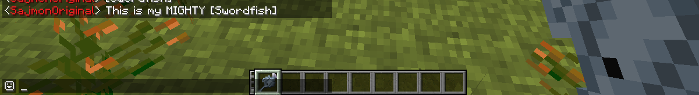
  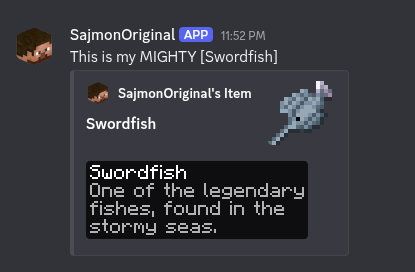
   
  <em>[item] in the game and the picture it sends to Discord.</em>

## Chat

- Messages go both ways, with each player's name and head on Discord
- Joins, leaves, deaths, skipped nights and server start and stop are announced
- Bold, italics, underline, strikethrough and spoilers work in both directions
- Replies, attachments and stickers from Discord show up in the game
- `@name` in the game mentions that person on Discord. `@everyone` and `@here` never ping

  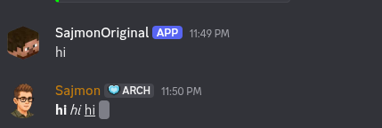
  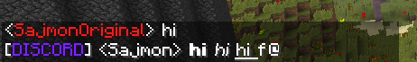
   
  <em>Formatting from Discord in the game. Spoilers stay hidden as scrambled text.</em>

  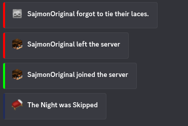

## Items and inventories

Write `[item]` or `[i]` in chat to show the item in your hand, and `[inv]` or `[inventory]` to show your inventory. The pictures use the game's own textures, font and tooltip style, and also cover items from other mods.

  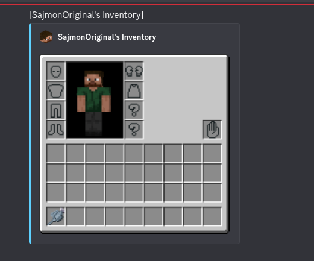
  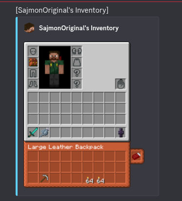
   
  <em>Inventories with Aether accessory slots, the offhand slot and a worn backpack.</em>

- Your skin and armor on the player model
- Backpacks from Better With Bags show their contents, and a worn backpack shows on your back and under the inventory
- Aether accessory slots, gloves, pendants and capes
- The offhand slot from Better With Hands
- Maps are drawn under their tooltip

  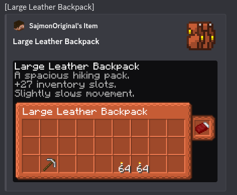
  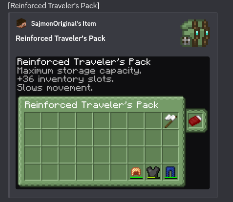
  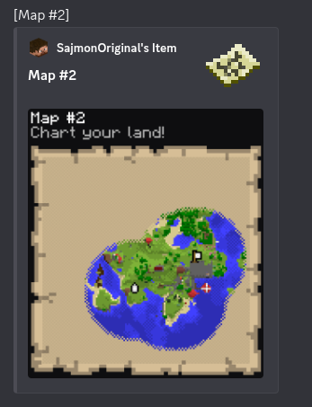
   
  <em>Backpack contents and a map, drawn inside the tooltip.</em>

## Images from Discord

When someone posts an image on Discord, the game shows it as `[image.png] /preview 3`. Type the command to hold the image as a map. GIFs play. Switching slots puts your item back.

  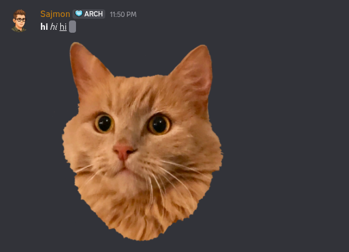
  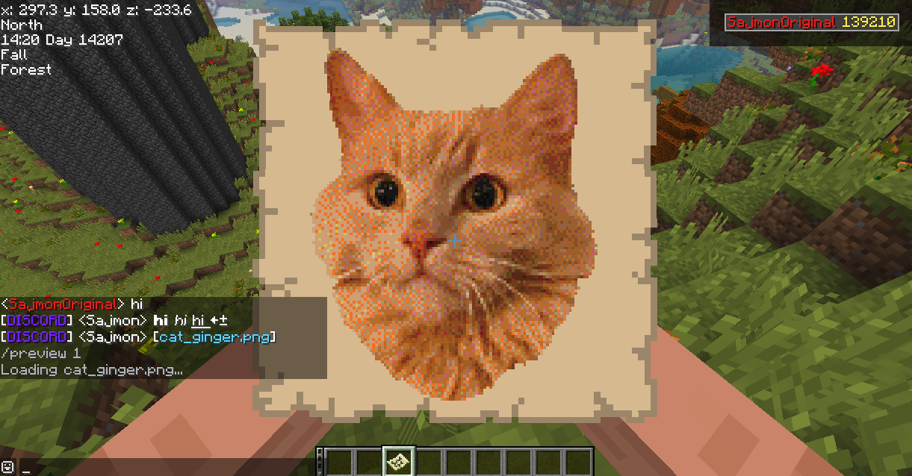
   
  <em>An image from Discord held as a map after /preview.</em>

## Commands

| Command | Where | Description |
|---------|-------|-------------|
| `/preview [number]` | game | Hold an image from Discord as a map, the last one if no number is given |
| `/playerlist` | Discord | Picture of who is online, like the tab list |

  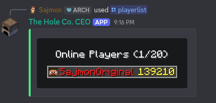
   
  <em>/playerlist on Discord, drawn like the tab list.</em>

## Console

The server console can be mirrored to a second Discord channel. Messages sent there run as commands. Commands can be limited with a blacklist or a list of allowed commands, and every command from Discord is written to `logs/better_with_discord-commands.log`.

## Setup

1. Create an application in the [Discord Developer Portal](https://discord.com/developers/applications) and add a bot
2. Turn on **Message Content Intent** in the **Bot** tab
3. Invite the bot with the `bot` and `applications.commands` scopes and these permissions: View Channels, Send Messages, Manage Webhooks, Embed Links, Attach Files
4. Start the server once, then fill in `config/better_with_discord.cfg`
5. Restart the server

| Setting | Default | Description |
|---------|---------|-------------|
| `discord.enable` | `false` | Turns the mod on |
| `discord.token` | | Bot token |
| `discord.channel` | | ID of the chat channel |
| `discord.server_name` | `Server` | Name used for server messages |
| `discord.server_avatar_url` | `https://i.imgur.com/dJUId0O.png` | Avatar used for server messages |
| `discord.show_player_count` | `true` | Online players as the bot status |
| `discord.watchdog_seconds` | `60` | Warn when the server stops responding, `0` turns it off |
| `discord.item_images` | `true` | Pictures for `[item]` and `[inv]`, downloads the BTA client once for its textures |
| `discord.tooltip_style` | `default` | Tooltip style, as in the game options |
| `discord.image_preview_seconds` | `60` | How long `/preview` lasts, `0` turns it off |
| `console.enable` | `false` | Mirrors the console |
| `console.channel` | | ID of the console channel |
| `console.commands` | `true` | Run messages in the console channel as commands |
| `console.command_prefix` | | Only run messages starting with this |
| `console.command_blacklist` | `stop, op, deop, ban, unban` | Commands that can't be run from Discord |
| `console.allowed_commands` | | When set, only these commands can be run |

## Requirements

- BTA == 8.0.1
- HalpLibe >= [6.2.0+8.0.1](https://github.com/Turnip-Labs/bta-halplibe/releases)
- Java 17

## License

See [LICENSE](LICENSE). Short version: free for personal use and free modpacks with attribution, no commercial use without permission.
